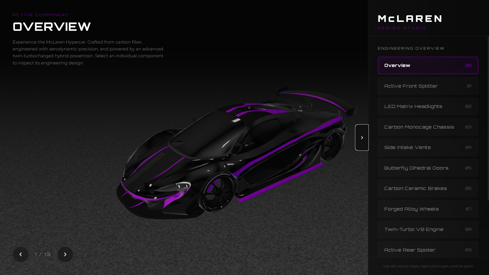

# 🏎️ McLaren 3D Interactive Showroom

An immersive, high-end 3D product showcase demonstrating a McLaren hypercar inside a dark studio gallery. This project brings standard automotive models to life with interactive annotations, smooth camera dynamics, and specialized studio lighting.



---

## ✨ Features

* **Stealth Studio Lighting:** Dim, high-contrast lighting utilizing custom PMREM environment reflections and subtle neon highlights to trace the carbon body.
* **Seeded Charcoal Floor:** A detailed, non-tiled grungy concrete floor generated procedurally and mapped standardly to catch organic shadows consistently on every reload.
* **Dynamic 3D Annotations:** Projected HTML cards connected to 3D coordinates on the model via real-time vector projections and custom SVG lines.
* **Orbit Control Constraints:** Seamless zoom boundaries (`minDistance` clamps) to prevent the viewport camera from clipping into the car model while allowing close-up detail inspections.
* **Cinematic Transitions:** GSAP-powered orbital camera path sweeps focusing smoothly on 12 critical vehicle components.

---

## 🛠️ Tech Stack

* **Core:** HTML5, CSS3, Javascript (ES6 modules)
* **3D Engine:** Three.js (WebGL, OrbitControls, GLTFLoader, RoomEnvironment)
* **Animations:** GSAP (GreenSock Animation Platform)
* **Dev Tools:** Vite

---

## 🚀 Installation & Local Run

Follow these steps to run the project locally:

1. **Clone the repository:**
   ```bash
   git clone https://github.com/anujsehrawat1/mclaren-3d-showroom.git
   cd mclaren-3d-showroom
   ```

2. **Install dependencies:**
   ```bash
   npm install
   ```

3. **Run the development server:**
   ```bash
   npm run dev
   ```

4. Open the local address in your browser: `http://localhost:3000`

---

## 📂 Project Structure

```
├── 3dModel/            # 3D Assets (moved to public/ for static serving)
├── public/
│   ├── 3dModel/        # glTF model parts (scene.gltf, scene.bin, textures)
│   └── screenshot.png  # Showroom screenshot preview
├── index.html          # Structure & UI markup
├── style.css           # Premium dark styles & UI layouts
├── main.js             # Three.js render loop & interactive logic
├── vite.config.js      # Vite build config
└── package.json        # Node modules & execution scripts
```

---

## 📄 Attributions & Credits

This work is based on **"McLaren P1 GTR 2015"** by [LC Design ⓥⓘⓟ](https://sketchfab.com/h.e.l.l.o_) licensed under [CC-BY-4.0](http://creativecommons.org/licenses/by/4.0/).
Original 3D Asset Link: [Sketchfab Model Source](https://sketchfab.com/3d-models/mclaren-p1-gtr-2015-187bdc110d16417e8a02e71af4ebd8d8)

